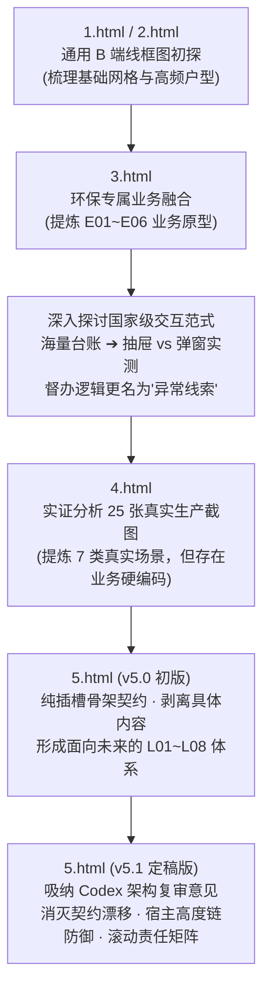

# 国家级生态环境业务系统前端布局契约与架构评审文档 (v5.1 定稿版)

> **文档定位**：本规范用于指导国家级/省部级大中型生态环境监测监控系统（包含重点污染源自动监控、水环境非现场执法、异常线索排查、排污许可、运维设备系统等）的前端通用布局设计，建立“需求 ➔ 布局编号 ➔ 插槽填空 ➔ 代码生成”的标准化协同闭环，已完成多 Agent 闭环复审，作为生产级架构定稿基准。

---

## 一、 业务背景与架构动因

### 1.1 业务特征
* **层级深与数据体量大**：覆盖“生态环境部 ➔ 省厅 ➔ 市局 ➔ 区县分局 ➔ 重点排污单位 ➔ 监控点位/排口 ➔ 监测仪器/数采仪”。单台账数据动辄数万至十余万条，日均报警线索数千条。
* **业务模型高度收敛**：业务主线普遍围绕**“排污单位/设备全景台账 ➔ 因子时序数据采集 ➔ 算法异常线索研判 ➔ 现场排查与多级审批闭环 ➔ 宏观态势统计大屏”**展开。
* **两段式作业习惯**：由于筛选成本高，监管人员高频依赖**“宏观海量检索大列表（先筛选与横向比对） ➔ 微观下钻深入详情（抽屉/弹窗处理）”**的模式。

### 1.2 核心痛点与工程治理原则
* **高度必须来自所属容器**：严禁在子应用布局中写死 `100vh`。微前端宿主已有顶栏与多标签页，子页面若强制 `100vh` 必导致外层滚动条溢出。正确规则为：**宿主提供可计算的可用高度 ➔ Layout 声明 `height: 100%` 满高填满；参与 flex 伸缩的中间层必须保持完整的 `min-height: 0; min-width: 0;` 链**。
* **明确滚动责任人（Scroll Owner）**：
  1. *普通长表单、长卷*：由布局内容区负责纵向滚动；
  2. *自带滚动的表格、虚拟列表*：由子组件自负责滚动，布局仅约束可用尺寸；
  3. *地图画布、图表*：无内部滚动，由组件监听 `ResizeObserver` 响应尺寸；
  4. *外层主视口*：声明 `overflow: hidden;`，严禁叠加外部同向滚动。
* **三权分立职责边界**：
  * **Layout 布局层**：仅负责几何网格、高度传递、滚动边界与公开插槽，严禁在 Layout 内部硬编码业务数据或强绑定业务组件；
  * **通用组件适配层**：负责表格内部测量、图表尺寸自适应与销毁、浮层外壳的挂载与动效；
  * **业务页面层**：负责条件对象、分页页码状态、接口调用、表单校验、草稿暂存以及浮层关闭后的上下文保存。

---

## 二、 方案演进与关键决策复盘



---

## 三、 L01 ～ L08 通用页面布局模板体系（定稿契约）

> 配套可交互蓝图文件：[5.html](./5.html)

### L01. 标准工作台检索布局（Standard Filter-Viewport-Page）
* **定位**：中后台最核心的基石，覆盖 65% 以上页面。
* **空间拓扑**：纵向单列流 (筛选区 ➔ 操作工具栏 ➔ 自适应主视口 ➔ 分页/底栏)。
* **高度与滚动**：宿主提供可用高度 ➔ 布局 `height: 100%`；中间视口显式声明 `flex: 1; min-height: 0; min-width: 0;`；滚动权归属 `el-table` 或虚拟列表自身；底部分页栏不被挤压。
* **公开插槽**：
  * `#filter-bar` (可选)：条件筛选插槽 (多维表单查询、级联区划、时间范围、查询/重置，支持折叠)
  * `#toolbar` (可选)：工具操作栏插槽 (新增、批量导出、批量下发、列设置、表/图双态切换按钮)
  * `#main-viewport` (必需)：核心数据视口插槽 (可接入：高密度大表格 / 虚拟滚动表 / 时序趋势对数折线图)
  * `#footer-bar` (可选)：底部分页与状态插槽 (状态图例、总条数、分页器)
* **业务映射**：一企一档列表、运维记录详情、异常线索台账、时序数据监测 (表/图双态)。

---

### L02. 侧栏联动主从布局（Sidebar Tree/Nav Split）
* **定位**：层级驱动型业务（树状结构决定右侧内容）。
* **空间拓扑**：横向双栏：左侧固定宽导航树（`240~280px`）+ 右侧自适应联动工作区（`1fr`）。可与 L03 共享双栏底层实现。
* **高度与滚动**：双轨独立滚动：左侧侧栏容器独立纵向滚动 (<code>overflow-y: auto</code>)；右侧工作区滚动权归属其装配内容，互不干扰。
* **公开插槽**：
  * `#sidebar-nav` (必需)：侧边树形导航插槽 (行政区划树、排污口层级树、分类目录树，带模糊搜索与分页)
  * `#content-header` (可选)：右侧顶部控制插槽 (当前选中节点摘要、业务维度 Tab 如视频查看/联网趋势、轻量筛选)
  * `#content-body` (必需)：联动主体内容插槽 (占满剩余高度，可接入：实时音视频视口 / 关联数据表格 / 因子对比分析图)
  * `#content-footer` (可选)：底部扩展插槽 (分页器、诊断状态说明)
* **业务映射**：视频监控通道树及实时监控、排口层级树与监测数据查阅、组织机构管理。

---

### L03. 双栏流转协同布局（Master-Detail Split Pane）
* **定位**：任务流转、事件调度与即席审批。
* **空间拓扑**：横向双栏：左侧主清单流（`280~360px`）+ 右侧从属详情与处理面板（`1fr`）。
* **高度与滚动**：双栏 100% 满高；左侧清单容器独立滚动 (带选中态高亮)；右侧处理面板独立纵向滚动；**右下角操作栏常驻吸底可见**。
* **公开插槽**：
  * `#master-filter` (可选)：主列表过滤插槽 (年份/批次下拉、状态过滤)
  * `#master-list` (必需)：卡片清单流插槽 (轮次卡片、督办任务流、工单待办卡)
  * `#detail-head` (可选)：从属对象摘要头插槽 (标题、预警等级、批量添加城市按钮)
  * `#detail-body` (必需)：从属核心工作区插槽 (现场证据链、整改填报表单、联动城市管理表格)
  * `#detail-actions` (可选)：吸底操作栏插槽 (退回、转交、保存草稿、审批销号)
* **业务映射**：重污染天气应急轮次管理、督办待办协同、双随机排查任务分派。

---

### L04. 全景空间底图 + HUD 浮层布局（GIS-HUD-Overlay）
* **定位**：指挥调度大厅、生态环境监管态势大盘。
* **空间拓扑**：底层 100% 视口全屏地图画布 + 上层 HUD 悬浮面板栅格（顶/左/右/底）。
* **交互与穿透**：无页面级滚动条；上层 HUD 容器包装层声明 `pointer-events: none`（**事件穿透到底层地图**，保障地图缩放、拖拽正常）；内部面板恢复 `pointer-events: auto`。
* **公开插槽（已消灭契约漂移）**：
  * `#canvas-bg` (必需)：底层全景画布插槽 (天地图 / 高德 / Mapbox / 3D 孪生，组件自负责响应 Resize)
  * `#hud-top` (可选)：顶部统揽指标栏插槽 (联网企业数、今日报警数、优良水体占比、区域切换器)
  * `#hud-left` (可选)：左侧态势分析插槽 (工作进展总览、数据分类图层树、达标率排行)
  * `#hud-right` (可选)：右侧实时事件插槽 (实时异常线索流、任务办理进度、预警处置卡)
  * `#hud-bottom-left` (可选)：图例说明插槽
  * `#hud-bottom-right` (可选)：空间工具插槽 (图层开关、测距、框选工具)
* **业务映射**：污染源监控监管端首页、水环境非现场执法监管大盘、水系流域一张图。

---

### L05. 复合双栏核查工作台（Dual-Pane Review Workbench）
* **定位**：国家级海量业务下的深度核查与两段式案卷审阅。
* **分层解耦原则**：**L05 是纯内容双栏核查布局**。浮层外壳直接由业务项目标准组件 `<CtcDialog>` 或 `<CtcDrawer>` 承载（48px 标题栏、全屏切换、关闭按钮与底部操作栏均由底层外壳原生管控，L05 无需重复定义顶栏与外壳）。单栏业务（L07 长卷、L08 向导、L01 表格）直接由外壳承载，无需经过 L05。
* **空间与滚动**：装配在启用了 `content-fill` 的 `CtcDialog` 或 `CtcDrawer` 中；外层宿主设置 `overflow: hidden; padding: 0;` 抑制嵌套滚动；左栏与右栏各自持有 `overflow-y: auto` 独立分轨滚动；**不破坏底层大列表的复杂筛选与分页上下文**。
* **公开插槽**：
  * `#pane-left` (必需)：静态证据/公文/详情审阅插槽 (部委红头函件正文 / 算法时序异常图表 / 现场照片瀑布流 / 企业基础档案，独立纵向滚动)
  * `#pane-right` (必需)：动态流转/审批/填报插槽 (四级审批流转步骤条 / 现场勘验结论录入 / 责任人签名 / 附件上传，独立纵向滚动)
* **业务映射**：国家部委交办问题线索函核查、重大环境违法案件审阅、涉案线索比对核实。

---

### L06. 响应式网格看板布局（Dashboard Grid Analytics）
* **定位**：综合统计分析、质量评估与领导驾驶舱。
* **空间拓扑**：全局维度筛选 ➔ N 联核心指标卡 (采用 CSS Grid `repeat(auto-fit, minmax(180px, 1fr))` 自动均分) ➔ 通用响应式图表网格。
* **解耦与响应**：已移除特型化图表命名，采用开放网格插槽；各图表卡片内部必须挂载 `ResizeObserver` 监听尺寸变化自适应 resize。
* **公开插槽（已消灭契约漂移）**：
  * `#dashboard-filter` (可选)：统计维度筛选插槽 (时间范围、行政区划、线索类别、按月/按日单选)
  * `#metric-cards` (可选)：指标卡片容器插槽 (可容纳 3~5 个大数字卡)
  * `#dashboard-grid` (必需)：主体开放网格插槽 (支持 2:1、2x2、3列等排布，装配柱状图/折线图/环形图/排行榜)
* **业务映射**：整改情况统计、运维质量统计、设备注册总览。

---

### L07. 锚点分段长卷档案布局（Anchor-Section Profile & Form）
* **定位**：排污许可全量申报、企业合规审计长报告。
* **空间拓扑**：顶部实体摘要 + (侧边浮动锚点轨 `160px` + 纵向多分段长卷 `1fr`) + **底部常驻吸底操作条**。
* **滚动与锚点**：**正文容器为唯一滚动根节点**；侧边锚点菜单悬浮跟随并高亮联动；操作栏位于滚动区外，自然贴底可见。
* **公开插槽（已消灭契约漂移）**：
  * `#profile-header` (可选)：实体核心概要插槽 (企业名称、信用代码、许可证号、环保信用评级)
  * `#anchor-nav` (必需)：锚点导航轨插槽 (1. 基本概况 ➔ 2. 治理设施 ➔ 3. 排放限值 ➔ 4. 自行监测)
  * `#sections-stream` (必需)：多分段长卷内容容器插槽 (统一长卷滚动，不在子卡片内嵌套局部滚动条)
  * `#sticky-actions` (可选)：吸底操作动作条插槽 (存为草稿、自动合规性比对校验、提交主管部门审核)
* **业务映射**：排污许可申报与核发、企业一企一档全量长档案录入、站房建设标准化台账。

---

### L08. 步骤向导受控流转布局（Step Wizard Funnel）
* **定位**：设备入网向导、复杂立案与初始化流程。
* **空间拓扑**：顶部步骤指示轨 (Step Tracker) + **中间当前步骤受控视口 (Stage Viewport)** + 底部动作导航轨。
* **滚动与边界**：**单视口受控切换**；布局负责当前视口承载，业务层负责步骤校验、草稿暂存与上下步跳转；当前步骤视口按内容自负责滚动。
* **公开插槽**：
  * `#step-tracker` (必需)：步骤轨迹指示轨插槽 (步骤条组件与当前激活步骤)
  * `#stage-viewport` (必需)：当前步骤受控工作台插槽 (仅聚焦当前阶段所需的表单或映射配置)
  * `#action-rail` (必需)：导航动作插槽 (上一步、保存草稿、下一步、最终提交)
  * `#step-summary` (可选)：步骤导引摘要插槽 (顶部/侧边提示说明或前置完成摘要)
* **业务映射**：数采仪入网联调向导、新企业档案初始化、重大环境事件立案分步流程。

---

## 四、 需求对齐与 AI 研发落地协议（Prompt 模板）

产品人员向开发或 AI 提需求时的统一标准范式：

```markdown
【页面名称】：重点排污单位异常线索核查台账
【采用布局】：L01（标准工作台检索布局）

【插槽内容装配】：
1. #filter-bar（筛选栏）：
   - 区划下钻（全国 31 省市）、行业门类（多选下拉）
   - 异常模型（超标/恒值/倒灌/断传）、核查状态（待下发/核查中/已销号）
   - 查询、重置按钮
2. #toolbar（工具栏）：
   - 批量下发核查指令（主按钮）、导出 Excel、批量标记误报
3. #main-viewport（核心视口）：
   - 接入高密度数据表格（需支持行冻结与超标倍数标红）
   - 操作列提供：[核查处置]，点击触发 L05 抽屉/大弹窗
4. #footer-bar（分页栏）：
   - 总条数统计与标准 Element Plus 分页器

【技术栈规范】：Vue 3 + <script setup lang="ts"> + Element Plus，严格遵循宿主高度链与收缩保护规则。
```

---
*文档更新定稿路径：`/Volumes/Atlas/01-Projects/company/ctc/ctc-fe-skills/ctc-fe-design-page/assets/resource/v1/LAYOUT_ARCHITECTURE_REVIEW.md`*
