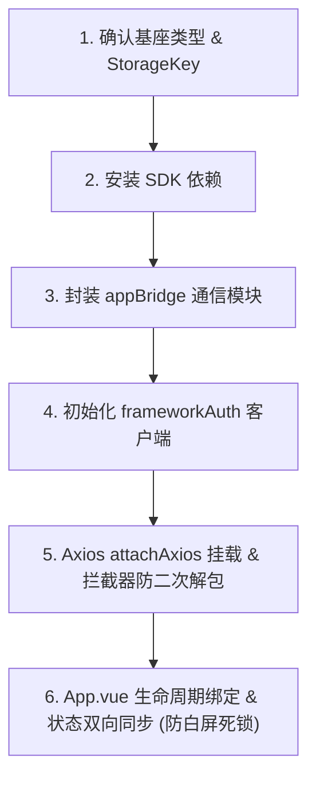

# CTC 微前端子应用鉴权与静默续租规范

本规范适用于所有作为 iframe 或微前端子应用接入集团各基座平台（如 `gf-monitor` 重点排污单位监控基座、`gf-law` 移动执法/法治基座）的前端业务系统。

核心目标是提供标准化的会话接入、401 并发静默续租、跨层状态双向同步以及防御性异常处理，杜绝 Token 过期导致的突发白屏与无感中断。

## 适用技术栈与框架无关性

- **核心 SDK**：`@ctc-front/gf-framework-auth@0.3.0` 与 `@ctc-front/bridge-next@0.2.0`。
- **框架中立**：SDK 不绑定 UI 框架；本技能提供 Vue 2（Options API + Vuex）和 Vue 3（Composition API + Pinia / Vuex 4）示例。接入前核对已安装 SDK 的导出、目标框架版本和项目构建配置。
- **构建适配**：不对 Vite、Webpack 4 或 Webpack 5 做通用兼容承诺；按消费项目的实际构建矩阵完成验证。

## 基座平台与 StorageKey 矩阵（速查）

| 基座平台名称 | 基座代码标识 | 基座 LocalStorage Key | 典型接入子应用 |
| :--- | :--- | :--- | :--- |
| **重点排污单位监控系统** | `gf-monitor` | `monitor-user-info` *(默认)* | `zdjk-system`、`zdjk-cockpit` |
| **生态环境移动执法/法治系统**| `gf-law` | `law-user-info` | `shj-fxc-biz` |

> 接入前务必确认子应用所挂载的目标基座。若挂载到 `gf-law`，必须显式配置 `storageKey: 'law-user-info'`。详细平台实践见 [references/platforms.md](references/platforms.md)。

## 接入核心流程与规范（MUST）

子应用接入基座鉴权必须遵循以下 6 步标准流程：



### 1. 依赖安装

使用团队私有 npm 仓库安装正式稳定版：

安装前确认已配置团队指定的 npm registry 与只读访问凭据。按团队私服文档将 token 放入本机环境变量或凭据管理器，不要写入仓库；例如私服若支持 npm token，可在本机 `.npmrc` 配置：

```ini
@ctc-front:registry=https://<company-registry>/
//<company-registry-host>/:_authToken=${CTC_NPM_TOKEN}
```

将占位符替换为团队 registry 信息，并确认 `CTC_NPM_TOKEN` 已设置；registry 地址和认证路径以团队私服配置为准。

```bash
# pnpm
pnpm add @ctc-front/gf-framework-auth@0.3.0 @ctc-front/bridge-next@0.2.0

# npm
npm install @ctc-front/gf-framework-auth@0.3.0 @ctc-front/bridge-next@0.2.0 --save
```

### 2. 通信模块与客户端初始化

- **存量 GF 项目**：模板默认沿用 `src/common/utils/appBridge.js` 与 `src/common/utils/frameworkAuth.js`，以减少对既有别名和导入的影响。
- **采用 `ctc-fe-structure` 的新项目**：将 Bridge 与 SDK 客户端放在 `src/services/auth/`（或项目已确定的服务目录），Axios 实例放在 `src/services/request.ts`；不要照搬旧项目路径。参见模板 [references/templates/appBridge.js](references/templates/appBridge.js) 与 [references/templates/frameworkAuth.js](references/templates/frameworkAuth.js)。

### 3. Axios 拦截器改造（MUST 门禁）

在项目的请求客户端文件中改造拦截器逻辑（存量 GF 项目常见路径为 `src/common/utils/request.js`，新项目可使用 `src/services/request.ts`），必须满足以下硬性条件：

1. **挂载顺序**：`frameworkAuth.attachAxios(service, options)` **必须在自定义业务响应拦截器之前调用**。Axios response 拦截器按 FIFO 执行，若业务拦截器先执行会将 401 提早当做错误 reject，导致 SDK 重试队列无法接管。
2. **防二次解包守卫**：重试成功的请求会重新穿透整个响应拦截器链。必须在响应拦截器开头添加守卫判断（如 `if (res && res.code !== undefined && !res.request && !res.headers) return res`），避免解包后的数据再次解包导致 undefined 异常。
3. **未授权识别**：准确配置 `isUnauthorized` 规则，覆盖 HTTP 401/402/403 及网关业务码（如 `40108`）。

参见标准实现 [references/templates/request.snippet.js](references/templates/request.snippet.js)。模板里的 `Notification` 是项目 UI 通知适配器，接入时必须从实际组件库导入或替换为项目已有的通知方法；它不是浏览器内置对象。

### 4. 状态双向同步与防白屏死锁（MUST 门禁）

在根组件（`App.vue`）中建立会话同步：

1. **初始同步**：初始化时从基座 LocalStorage 及 URL 参数（`t__` / `token`）同步初始 Token 至状态库（Pinia / Vuex）。
2. **续租订阅**：通过 `frameworkAuth.subscribe` 监听基座续租广播，Token 更新时双向写回状态库。
3. **防死锁保护**：首屏获取用户信息或初始字典时，**必须使用 `try ... catch ... finally` 包裹**，并在 `finally` 中保证骨架屏状态标记（如 `isLoaded`）置为 `true`，防止首屏请求因 401 挂起或网络故障导致页面永久停留在加载动画中。
4. **Vue 2 生命周期禁忌**：Vue 2 下严禁在 `beforeCreate` 中调用 methods 进行鉴权同步，必须在 `created` 中执行。

- Vue 3 实现模板：[references/templates/vue3/App.vue.snippet.vue](references/templates/vue3/App.vue.snippet.vue) 与 [references/templates/vue3/useFrameworkAuth.ts](references/templates/vue3/useFrameworkAuth.ts)。旧项目可放入 `src/common/composables/`；新架构按消费者放到 `src/app/composables/` 或对应业务子域，并调整其中 `frameworkAuth` 的导入路径。
- Vue 2 实现模板：[references/templates/App.vue.snippet.vue](references/templates/App.vue.snippet.vue)

## 规范等级与检查清单

| 规则 | 等级 | 说明 |
| :--- | :---: | :--- |
| 同源反向代理部署 | MUST | 基座与子应用必须部署在同源同域下，否则 LocalStorage 事件与 Bridge 通信均失效 |
| 正确配置 storageKey | MUST | 严禁在 `gf-law` 基座项目中使用默认的 `monitor-user-info` |
| attachAxios 前置挂载 | MUST | 必须优先于业务响应拦截器执行 |
| 响应拦截器防二次解包 | MUST | 对已解包结构增加对象守卫 |
| 初始加载 try/finally | MUST | 首屏骨架屏加载必须在 finally 中结束，杜绝白屏死锁 |
| 禁止 401 主动强退 | MUST | 静默续租阶段禁止向基座主动发出 doLogout 广播，避免冲刷基座正常重试流程 |
| Pinia / Vuex 状态同步 | SHOULD | 会话变更时及时更新应用内用户状态，保持单向数据流一致 |

## 分册索引（按需调阅）

- 📌 基座平台矩阵、StorageKey 对照与改造备忘录 → 读 [references/platforms.md](references/platforms.md)
- 📌 踩坑避雷清单、生命周期陷阱与防御性编程守则 → 读 [references/troubleshooting.md](references/troubleshooting.md)
- 📌 Vue 2 / Vue 3 标准接入代码模板目录 → 查阅 [references/templates/](references/templates/)
